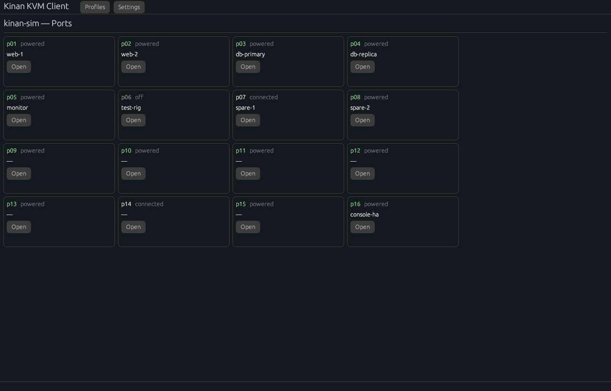
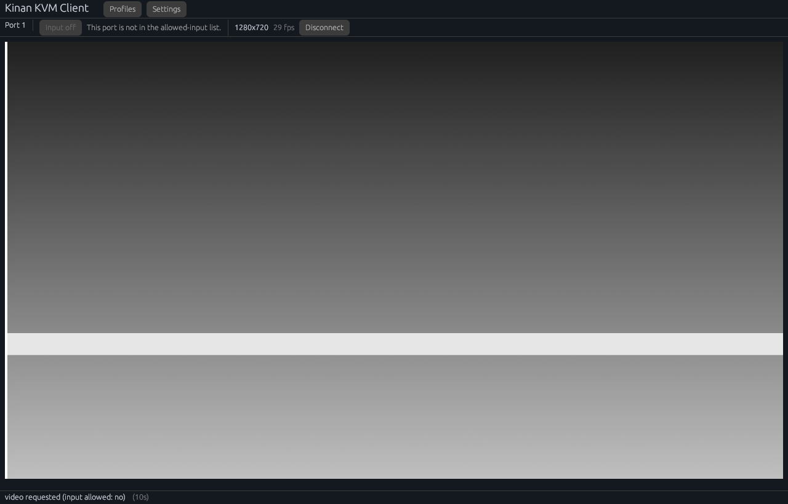
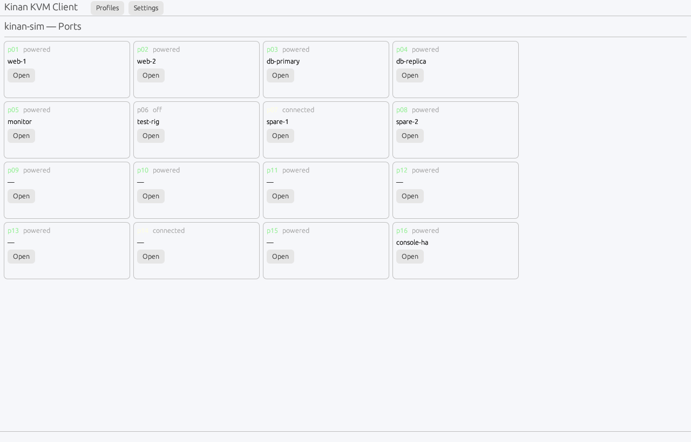
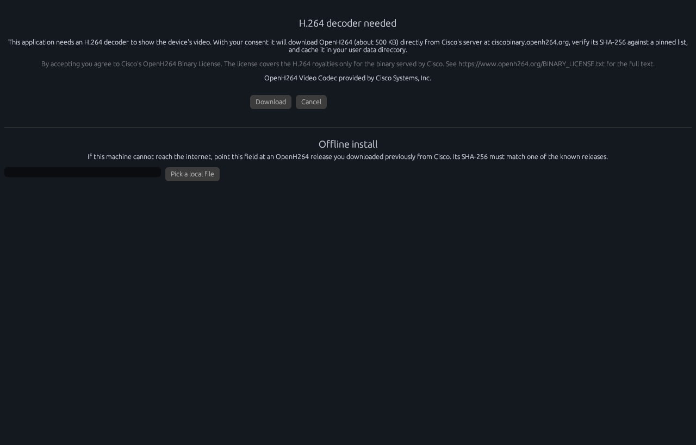

# Kinan KVM Client

> **Uniquement sur un réseau de gestion isolé.** L'appareil contrôlé par ce
> client n'a **aucune authentification** sur ses ports vidéo, de commutation
> et clavier/souris. N'importe qui sur le même segment réseau peut voir tous
> les écrans et taper sur tous les serveurs connectés. Déployez le
> commutateur sur un VLAN de gestion dédié, jamais sur un réseau partagé ni
> sur Internet. Pour un accès distant, passez obligatoirement par un VPN ou
> un tunnel SSH. Voir [`SECURITY.md`](SECURITY.md).

Client open source, moderne et multiplateforme, pour les commutateurs KVM
sur IP fabriqués par Kinan (également vendus sous diverses marques de
revendeurs). Le client officiel exige Internet Explorer et un contrôle
ActiveX ; celui-ci est un binaire Rust autonome avec une interface
eframe/egui, un décodage H.264 via OpenH264, et des traductions en anglais,
français et chinois simplifié.









> Chaque capture ci-dessus est le client connecté à `kinan-sim`, pas à un
> appareil réel.

## Fonctionnalités

* Écran de connexion et profils d'appareils enregistrés sous
  `~/.config/kinan-kvm-client/` (et équivalents selon la plateforme).
* Grille des 16 ports avec état et libellés personnalisables.
* Visionneuse vidéo H.264, compteur de résolution et d'images/s,
  indicateur « aucun signal ».
* **Saisie clavier/souris optionnelle** : désactivée par défaut, autorisée
  port par port, confirmée par une boîte de dialogue. Chaque paquet porte
  le numéro du port de session et le client refuse d'envoyer un paquet lié
  à un autre port.
* Raccourci Ctrl+Alt+Suppr, relâchement des touches à la fermeture.
* Thèmes clair et sombre, trois langues (anglais, français, chinois
  simplifié).
* Avertissement au premier lancement, et rappel dans l'UI quand l'hôte ne
  semble pas être privé, en loopback, link-local ni CGNAT/Tailscale.

## État

Projet jeune. Priorité à ce qui est publiable et utile, pas au
fonctionnellement complet.

* Les réglages image (luminosité, contraste) et les médias virtuels
  (`RemoteVM`) ne sont pas implémentés.
* Le protocole est validé sur une seule révision de firmware. Rapports
  d'autres révisions bienvenus.

## Installation

Des binaires pour Windows (et, quand la chaîne le permet, Linux) sont
publiés avec chaque tag sur GitHub Releases. Télécharger, décompresser,
lancer `kinan-kvm-client`.

## OpenH264 téléchargé au premier lancement

Aucun décodeur binaire n'est embarqué dans le projet. Au premier
lancement, l'application récupère la version officielle d'OpenH264
correspondant à la plateforme depuis `ciscobinary.openh264.org`, vérifie
son empreinte SHA-256 par rapport à une liste pré-enregistrée et met le
fichier en cache dans le répertoire utilisateur (`~/.local/share/kinan-kvm-client/openh264/`
sous Linux, `AppData\Roaming\` sous Windows, `~/Library/Application Support/`
sous macOS). Les lancements suivants utilisent le fichier en cache.

La licence binaire Cisco ne couvre les redevances H.264 **que** pour un
binaire obtenu depuis leur serveur ; compiler OpenH264 depuis les sources
et redistribuer le résultat ne donne pas la même couverture. Récupérer à
l'exécution place clairement le projet du bon côté de cette ligne. Voir la
[OpenH264 Binary License](https://www.openh264.org/BINARY_LICENSE.txt)
pour la formulation officielle.

> **OpenH264 Video Codec provided by Cisco Systems, Inc.**

## Compilation depuis les sources

Rust 1.75 ou plus récent.

* **Windows** : rien de plus que la chaîne MSVC (ou MinGW) installée par
  Rust lui-même.
* **Linux** : les bibliothèques système de `winit`/`glow` (`libgl1`,
  `libxkbcommon-x11-0`, `libwayland-dev`, `libfontconfig1-dev`).
* **macOS** : outils en ligne de commande Xcode.

```sh
cargo build --release
./target/release/kinan-kvm-client
```

Pour une compilation croisée Linux → Windows, installer `mingw-w64` et
lancer :

```sh
cargo build --release --target x86_64-pc-windows-gnu
```

## Simulateur

Le dépôt inclut un petit simulateur — `kinan-sim` — qui implémente assez
du protocole pour piloter le client sans appareil réel : mire H.264
générée, liste des ports, canal de commutation, et absorption des paquets
clavier/souris. Utile pour le développement, les tests et les captures
qui ne montrent pas de vraie console.

```sh
cargo run -p kinan-sim -- --bind 127.0.0.1 --web-port 8080 \
    --switch-port 8777 --video-port 8202 --km-port 8203
```

Lancer ensuite le client et créer un profil pointant sur `127.0.0.1` avec
ces ports. Le champ `device_ip` peut aussi valoir `127.0.0.1`.

## Atteindre un vrai commutateur

L'appareil n'a aucune authentification ; ne jamais l'exposer directement.
Configuration recommandée :

* Placer le commutateur sur un VLAN de gestion qui ne route nulle part
  ailleurs.
* Depuis un poste qui n'est *pas* sur ce VLAN, ouvrir un tunnel SSH vers
  un rebond interne et pointer le client sur le tunnel :

```sh
ssh -N \
  -L 127.0.0.1:18080:<kvm>:80 \
  -L 127.0.0.1:18202:<kvm>:202 \
  -L 127.0.0.1:18203:<kvm>:203 \
  -L 127.0.0.1:18777:<kvm>:7777 \
  <rebond>
```

Dans le profil, `host = 127.0.0.1`, les ports du tunnel, et
`device_ip = <IP réelle de l'appareil>`.

## Identifiants d'usine

Beaucoup de ces appareils sortent d'usine avec le nom d'utilisateur
`admin` et le mot de passe `admin`, comme le documente le fabricant.
Changez-les. Le client ne présume rien de ce que vous utilisez.

## Firmware testé

* `V1.01-F17050CA20B35` (variante dite `KVM-160219IP`), modèle 16 ports.

## Non affilié

Projet non affilié au fabricant, ni soutenu par lui. Les marques et noms
de modèles ne sont utilisés que pour l'interopérabilité.

## Licence

Au choix de l'utilisateur :

* Licence MIT ([LICENSE-MIT](LICENSE-MIT))
* Licence Apache 2.0 ([LICENSE-APACHE](LICENSE-APACHE))

## Avis tiers

Voir [`NOTICE`](NOTICE) pour les licences du code tiers embarqué.
